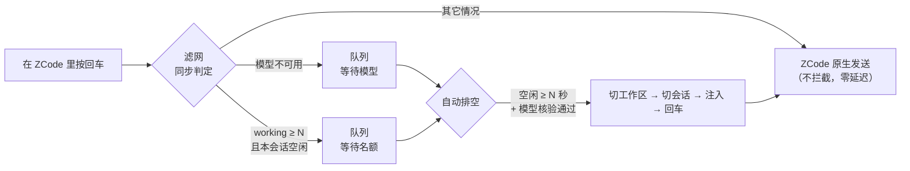

<p align="center">
  
</p>

<h1 align="center">ZCode Helper</h1>

<p align="center"><b>给 ZCode 桌面端加一个队列：发不出去的消息先存着，能发的时候自动送进正确的会话。</b></p>

<p align="center">
  
  
  
  
</p>

---

## 这是什么

这不是 ZCode 的官方插件，也和官方没有关系。它是一个独立的 Electron 小程序，通过 Chrome DevTools Protocol（CDP）操作**你已经安装、已经登录的 ZCode 桌面端**——等价于替你点按钮、替你按回车，不修改 ZCode 的任何文件。

它只解决一件事：**当你现在发不出去（没套餐 / 并发满了）时，把想说的话先存下来，等能发的时候按顺序送回去。**

## 功能

- **对话异常结束时，自动重发「继续」。** 检测侧栏会话上的红点（ZCode 用它标记上次运行出错），如果队列里没有该会话待发的「继续」，就在队首插入一条。同一会话 5 分钟内最多 3 条，红点消失后重新计数。
- **实时检测同时工作的会话数，在同时开始多会话时提供队列缓存，避免限额。** 超过你设置的并发数时，消息先入队；有空位再按 FIFO 自动发送，同会话串行、跨会话可并行。
- **无套餐时暂存对话，在可用时自动恢复，适用于 WEEKEND BUILD 等限时免费场景。** 模型不可用时消息只入队不发送，灯条转黄；恢复可用后自动继续。

## 实现

- 使用 ZCode 自带的 CDP 接口进行操作（`--remote-debugging-port=9222 --remote-allow-origins=*`），**不修改 ZCode 客户端**，不注入 DLL，不 hook 网络。
- 只操作 Electron DOM：读元素、派发真实的鼠标点击/键盘事件，**不分析 ZCode 的对话数据**。
- 附件路径来自 ZCode 页面自己暴露的桥（`window.zcode.getPathForFile`，即 Electron 的 `webUtils`），helper 只是调用它，不去猜路径。
- 单机版本，没有遥测，不上传任何数据。
- 唯一一处不属于 DOM 的读取：**系统级键鼠空闲时间**（Electron `powerMonitor.getSystemIdleTime()`）。它只用来实现「防打扰」——你刚刚动过键盘/鼠标（在任何程序里都算），helper 就不自动发消息、也不弹模型菜单。
- 会话是否"正在工作"完全来自 DOM：侧栏项的 spinner 类名 + 当前会话的 `chat-loading` 节点。

## 安装

**直接使用源码：**

```bat
git clone https://github.com/<you>/zcode-helper.git
cd zcode-helper
npm install
npm start
```

要求：Windows 10/11、Node.js ≥ 22、已安装并登录 ZCode。
helper 启动时会自动在常见安装位置（LocalAppData / Program Files / Scoop）找 `ZCode.exe`，找不到就用设置里的「浏览…」手动指定。
已测试的 ZCode 版本：**3.18.x ~ 3.19.x**（更早或更新的版本未验证，DOM 可能变化）。

也可以直接双击仓库里的 **`run.bat`**：首次会自动 `npm install`，之后重复双击只会聚焦已运行的实例。

**Release 安装：**

到 [Releases](https://github.com/<you>/zcode-helper/releases) 下载对应架构的产物：

| 文件 | 说明 |
|---|---|
| `ZCode-Helper-Setup-<版本>-<x64\|arm64>.exe` | 安装版（可选安装目录） |
| `ZCode-Helper-Portable-<版本>-<x64\|arm64>.exe` | 免安装便携版 |

**exe 没有代码签名**，Windows 首次运行会弹 SmartScreen：点「更多信息 → 仍要运行」即可。

## 界面

<p align="center">
  
  <br/>
  <sub>灯条（嵌在 ZCode 页面右侧）：灯色 + 工作进程数 + 队列长度 + 当前会话待发的第一条</sub>
</p>

<p align="center">
  
  <br/>
  <sub>主面板：暂停 ZCode 助手 / 设置 / 查看队列 / 重启受控 ZCode</sub>
</p>

<p align="center">
  
  <br/>
  <sub>队列窗口：分「提交 / 草稿」，可手动提交或上屏</sub>
</p>

## 它是怎么工作的



几个要点：

- **放行不经过 helper**：判定在页面内同步完成，条件不满足才拦；拦下来时清空输入框、把内容存进队列。
- **发消息是一个完整动作**：防打扰闸门（系统空闲 ≥ 设定秒数）→ 切工作区 → 展开项目（侧栏收起时先展开）→ 切会话 → 校验会话 id → **确认该会话没在跑** → **确保模型就绪**（必要时刷新列表 / 在面板里挑白名单模型）→ 检查草稿 → 注入 → 再校验一次会话 id → 回车 → 校验输入框已清空 → 确认会话真的跑起来。
- **切不过去就不发**：目标会话不在侧栏、或者提交前发现打开的会话变了，直接中止这一条并标记失败，绝不降级发进你正在看的会话。
- **项目收起也能找回来**：侧栏的项目可以折叠，收起后会话节点会从 DOM 消失；队列条目记了项目名，发送前会先展开对应项目。

## 使用

### 灯条

| 灯色 | 文字 | 含义 |
|---|---|---|
| 🟢 | 助手工作中 | 已连接，无积压，消息正常放行 |
| 🟡 | 限额缓冲 | 有积压且暂时发不出去（并发满或模型不可用） |
| 🔴 | 消息阻断 | 手动开启了「消息阻断」开关（调试用），一律不输出 |
| ⚪ | 助手已暂停 | 滤网放行，消息直接进 ZCode（等于暂停记录） |

灯条可拖动，松手吸附最近的角或边（角优先，100px 内），位置会记住。

### 主面板

- **暂停 ZCode 助手**：暂停记录，消息不再入队（同时也失去并发保护）；
- **设置**：ZCode 路径、默认工作区、允许同时进行的会话数、防打扰、模型列表刷新周期、允许助手使用的模型等；
- **查看队列(n)**：n 只统计「待发送 + 草稿」；
- 右上角的 **消息阻断** 小开关：调试用途，强制只入队不发送。

### 队列

每条消息带**项目**和**对话**，分「提交」和「草稿」两类：

- 提交：可手动「提交」，或等自动排空；红点触发的「继续」也是提交类，插在队首；
- **新建会话的第一条消息**也能排队：这种会话在侧栏还没有条目，排队时记下输入框上方那个"项目"抽屉里选的项目；回放时到这个项目里点「新建任务」现开一个会话，再把消息（含附件）发出去。项目显示为「选择项目」时无法自动定位，会明确失败而不是乱发。
- **附件**：消息里的图片/视频/文件会跟着消息一起暂存。来自磁盘的附件只记**绝对路径**——回放时把同一路径塞回 ZCode，所以模型看到的路径和原来完全一致，也不额外占磁盘；粘贴类没有原文件，存成内联 data URL。队列里按上屏后的样子显示缩略图，文件不在了就交给 Chromium 显示破图；
- 草稿：发送时从输入框里抢救出来的内容，点「上屏」放回输入框，不会自动发送。

### 设置项里值得注意的两个

- **防打扰（默认 5 秒）**：检测的是**整个系统**的键鼠活动。你在任何程序里操作，helper 都会等你停手 N 秒后才开始自动发送；0 = 关闭。
- **允许助手使用的模型（半角逗号分隔）**：只允许 helper 选这些模型，避免误用收费模型。按**从上到下的顺序**、**完整相等（区分大小写）**匹配，例如 `glm-5.3-flash, GLM-5.3-Flash` 会优先选小写的那个。
  - helper 会先记住"上次选中的供应商 + 模型"，下次直接用；当这个组合在面板里消失（供应商没了或模型改名）才重新扫描**所有供应商**，再按上面的顺序挑一个。
  - 对话框显示「管理模型」表示客户端连模型列表都没有，此时 helper 会按「模型列表刷新周期」点进模型设置页再返回，把列表刷出来。

## 已知限制

- **Windows only**：托盘、窗口、系统空闲检测都按 Windows 实现。
- **依赖 ZCode 的 DOM**：ZCode 升级可能让选择器失效，此时日志会报 `probe: adapter-blind` 并 dump 结构。适配层集中在 `src/dom-adapter.js`，方便修。
- **"异常结束"用的是红点信号**：红点只说明"上次出错了"，分不出是断网、超限还是别的原因；所以自动「继续」可能在不该继续的时候也补一条——目前靠"同一会话 5 分钟最多 3 条 + 红点消失才重置"来收口。
- **working 数可能少算**：只统计"侧栏显示 spinner 的会话 + 当前会话的 chat-loading"。后台会话如果只显示未读点、不显示 spinner，会被漏算（这也是我们不把它当唯一判据的原因：发送前还会现场再读一次目标会话的 chat-loading）。
- **模型可用性靠两层判断**：先看对话框是「管理模型」（没有列表）还是「选择模型」（有列表），再在面板里找设置白名单里的模型；客户端的模型状态是**每会话缓存**的，可能一直显示旧模型，只有真正发送被拒（额度横幅 / `ZCODE_RUNTIME_MODEL_UNAVAILABLE`）才会暴露。
- **模型不可用时会短暂切页面**：为了刷新列表，helper 会点进「模型设置」再点「返回工作区」，默认 60 秒一次、且只在你键鼠空闲时执行；嫌打扰可以把周期调大或设成 0 关闭。
- **未签名**：exe 没有代码签名，首次运行会有 SmartScreen 提示。
- **版本适配**：当前适配 ZCode **3.18.x ~ 3.19.x**（3.19.1 已实测）。ZCode 改版后先用 `npm run smoke:dom` 看哪个选择器失效。

## 开发

```bat
npm test              # 单元 + DOM 夹具
npm run test:unit     # 纯逻辑
npm run test:dom      # 在真实 Electron 渲染进程里跑 DOM 适配层
npm run smoke:dom     # 对着正在运行的 ZCode 逐个跑选择器（升级后第一件事）
npm run smoke:dom:read # 同上，但只读不点
npm run build         # 打包安装包 + 便携版
```

ZCode 端的手动验收清单见 [`docs/手动测试清单.md`](docs/手动测试清单.md)。

ZCode 升级后的维护流程：`npm run smoke:dom` 先看哪个选择器漂了（失败项会逐条列出）→ `scripts/dump-composer-dom.js` 抓结构 → `scripts/build-fixtures.js` 重新生成夹具 → `npm test` 看哪里失效。

发布：推一个 `v*` 标签即可触发 [`.github/workflows/release.yml`](.github/workflows/release.yml)，并行构建 x64 / arm64 并发布到 Releases。

## Roadmap

- [x] 附件 / 多模态消息（存原始路径，回放时原样塞回）
- [x] 模型可用性两层判断（列表是否存在 / 白名单模型是否存在）+ 供应商扫描 + 最佳匹配缓存
- [ ] 「继续」的触发条件细化（需要更多异常中断的案例，能区分"任务没做完"和"真的出错"）

## 许可

[MIT](LICENSE) © ZCode Helper contributors

> 本项目是个人工具，与 ZCode 官方无关；所有操作都通过 CDP 驱动你已经安装并登录的 ZCode 桌面端，不包含逆向或破解。

---

<details>
<summary><b>English</b></summary>

**ZCode Helper** is an unofficial Windows companion for [ZCode](https://zcode.z.ai). It queues messages that cannot be sent right now — because the model is unavailable, or because the concurrent-session limit is reached — and delivers them into the right conversation once they can go through. It also re-sends "continue" when a conversation ends with an error (detected by the red dot in the sidebar).

Everything goes through the Chrome DevTools Protocol against the real ZCode GUI: no patching, no proxy, no telemetry, no backend. The only non-DOM signal is the OS-wide keyboard/mouse idle time, used to avoid disturbing you. Tested against ZCode 3.18.x – 3.19.x.

MIT licensed; Windows x64 / arm64 builds are published on GitHub Releases.

</details>
