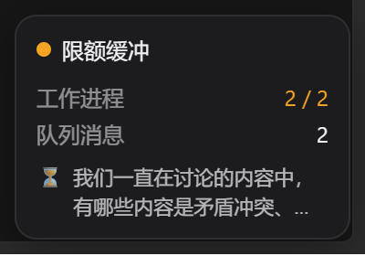
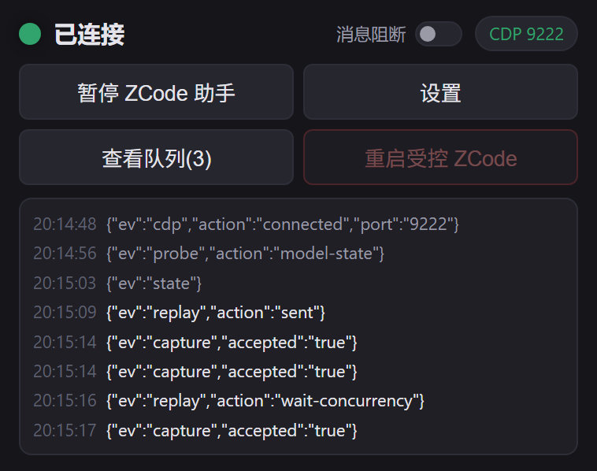

<p align="center">
  
</p>

<h1 align="center">ZCode Helper</h1>

<p align="center"><b>为 ZCode 桌面端添加自动发送重试和消息队列等功能。</b></p>

<p align="center">
  
  
  
  
</p>

> 非官方工具，与 ZCode 官方无关。它只是替你点按钮、按回车，不修改 ZCode 的任何文件。

## 它能做什么

- 并发满了先排队：同时工作的会话达到上限时，新消息先入队，有空位再按顺序自动发出。
- 模型不可用时（没套餐 / 额度用完）时暂时保存用户发送的指令，可用后自动发出。
- 会话因异常中断（侧栏出现红点）时，自动在队首补一条「继续」。同一会话 5 分钟内最多 3 条。
- 适配 ZCode 3.18.x ~ 4.0.x，ZCode 改版后可能需要更新本工具；
- 只接管 ZCode 的页面：9222 端口若被其它 Electron 应用占用，助手会跳过并换端口，绝不往别的应用里注入；
- 完全依赖 ZCode 的界面结构：ZCode 关闭或没带调试端口时，助手会显示「未受控」并提供重启按钮；
- 不上传任何数据，没有遥测。

## 安装

**下载安装包（推荐）**

到 [Releases](https://github.com/kaikaiiiiiii/zcode-helper/releases) 下载：

| 文件 | 说明 |
|---|---|
| `ZCode-Helper-Setup-<版本>-<x64\|arm64>.exe` | 安装版 |
| `ZCode-Helper-Portable-<版本>-<x64\|arm64>.exe` | 免安装便携版 |

exe 没有签名，首次运行 Windows 会弹 SmartScreen：点「更多信息 → 仍要运行」。

**从源码运行**

```bat
git clone https://github.com/<you>/zcode-helper.git
cd zcode-helper
npm install
npm start
```
## 使用

### 灯条

嵌入在 ZCode 主界面，显示实时状态。拖动可换位置，自动吸附到边缘。

<p align="center"></p>

| 灯色 | 文字 | 含义 |
|---|---|---|
| 🟢 | 助手工作中 | 已连接，无积压，消息正常放行 |
| 🟡 | 限额缓冲 | 有积压但暂时发不出去（并发满 / 模型不可用） |
| 🔴 | 消息阻断 | 手动开启了「消息阻断」，只入队不发送 |
| ⚪ | 助手已暂停 | 消息直接进 ZCode，等于暂停记录 |

### 主面板

<p align="center"></p>

- **暂停 ZCode 助手**：暂停记录，消息不再入队（同时失去并发保护）；
- **设置**：见下；
- **查看队列(n)**：查看暂存和已经发送的消息；
- **重启受控 ZCode**：ZCode 没带调试端口启动时用来接管；会话内容不会丢；
- 右上角 **消息阻断**：强制只入队不发送，调试用。

### 队列

<p align="center"></p>

- **提交**：用户在 ZCode 上发送的内容，在队列满时暂存于 helper 的消息队列中。
- **草稿**：用户遗留在 ZCode 输入框里的内容，点「上屏」放回输入框，不会自动发送。
- **附件**：消息中的图片 / 视频 / 文件会一起保存。

## 许可

[MIT](LICENSE) © ZCode Helper contributors

---

<details>
<summary><b>English</b></summary>

**ZCode Helper** is an unofficial Windows companion for [ZCode](https://zcode.z.ai). It queues messages that cannot be sent right now — the model is unavailable, or the concurrent-session limit is reached — and delivers them into the right conversation once they can go through. It also re-sends "continue" when a conversation ends with an error.

Tested with ZCode 3.18.x – 3.19.x. MIT licensed; Windows x64 / arm64 builds are on GitHub Releases.

</details>
